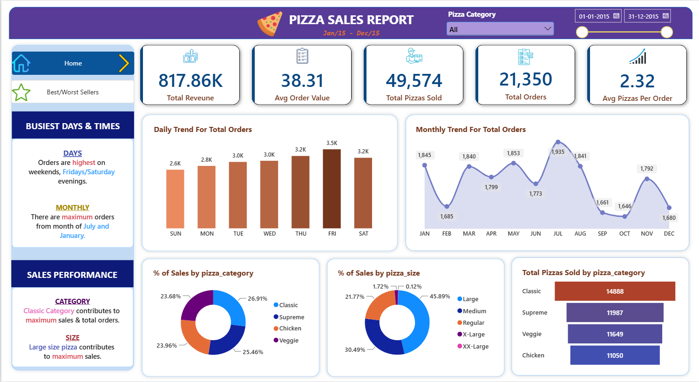
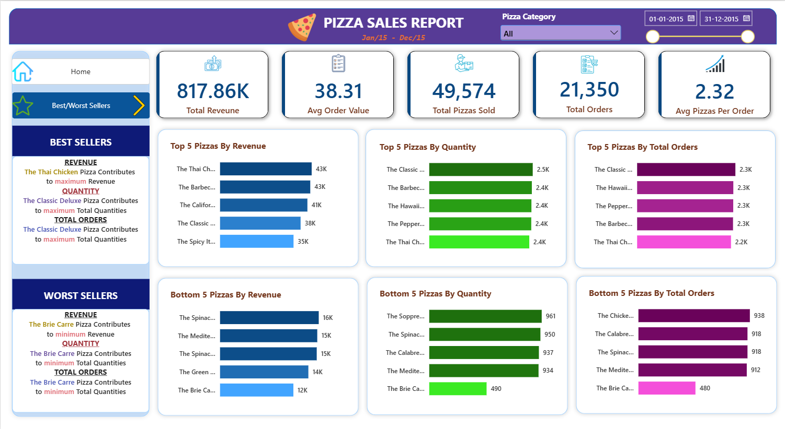

# 🍕 Pizza Sales Analysis — Power BI

An interactive **Pizza Sales Analysis Dashboard** built using **Power BI** to analyze revenue, orders, pizza quantity, product performance, sales trends, and best/worst-selling pizzas.

The project provides a complete business intelligence view of pizza sales performance for **January 2015 to December 2015**, with interactive filtering by pizza category and date.

---

## 📊 Dashboard Preview

### 🏠 Sales Overview



The Home dashboard provides an overview of overall sales performance, daily and monthly order trends, pizza category contribution, pizza size contribution, and total pizzas sold by category.

### 🏆 Best & Worst Sellers



The Best/Worst Sellers dashboard identifies the highest and lowest performing pizzas based on **Revenue, Quantity Sold, and Total Orders**.

---

## 📌 Project Overview

This project analyzes pizza sales data to identify important business trends and understand which pizzas, categories, sizes, and time periods contribute most to overall sales performance.

The dashboard transforms raw pizza sales data into interactive visual insights that can support business decisions related to product performance, sales strategy, and customer ordering patterns.

---

## 🎯 Project Objectives

- Analyze overall pizza sales performance
- Track total revenue and order volume
- Identify best-selling pizzas
- Identify worst-performing pizzas
- Analyze sales by pizza category
- Analyze sales by pizza size
- Understand daily and monthly order trends
- Identify the busiest days and times
- Compare pizza performance based on revenue, quantity, and orders
- Build an interactive business intelligence dashboard

---

## 📈 Key Performance Indicators

| KPI | Value |
|---|---:|
| 💰 Total Revenue | **817.86K** |
| 🧾 Average Order Value | **38.31** |
| 🍕 Total Pizzas Sold | **49,574** |
| 📦 Total Orders | **21,350** |
| 🍕 Average Pizzas Per Order | **2.32** |

---

## 🔍 Dashboard Analysis

### 1. Sales Performance

The dashboard provides a high-level view of:

- Total Revenue
- Average Order Value
- Total Pizzas Sold
- Total Orders
- Average Pizzas Per Order

### 2. Daily & Monthly Sales Trends

The dashboard analyzes order patterns across:

- Days of the week
- Months of the year
- Daily order trends
- Monthly order trends

### 3. Pizza Category Analysis

Sales performance is analyzed across:

- Classic
- Supreme
- Chicken
- Veggie

### 4. Pizza Size Analysis

The dashboard analyzes sales contribution across:

- Large
- Medium
- Regular
- X-Large
- XX-Large

### 5. Best-Selling Pizzas

The Best Sellers section identifies top-performing pizzas based on:

- Revenue
- Quantity Sold
- Total Orders

### 6. Worst-Selling Pizzas

The dashboard identifies the lowest-performing pizzas based on:

- Revenue
- Quantity Sold
- Total Orders

---

## 🏆 Key Business Insights

- Total revenue reached approximately **817.86K**.
- The business processed **21,350 total orders**.
- Customers purchased **49,574 pizzas**.
- The average order contained approximately **2.32 pizzas**.
- The average order value was **38.31**.
- Pizza performance can be compared using revenue, quantity, and order volume.
- Category and size analysis helps identify major contributors to sales.
- Daily and monthly trends provide insights into customer ordering patterns.
- Best and worst seller analysis helps evaluate product-level performance.

---

## 🛠️ Tools & Technologies

- **Power BI**
- **Power Query**
- **DAX**
- **Microsoft Excel**
- **SQL**
- **Data Cleaning**
- **Data Transformation**
- **Data Visualization**
- **Business Intelligence**

---

## 🔄 Project Workflow

```text
Raw Pizza Sales Data
        ↓
Data Cleaning
        ↓
Data Transformation
        ↓
Data Analysis
        ↓
DAX Measures
        ↓
Interactive Power BI Dashboard
        ↓
Business Insights
```

---

## 📂 Project Files

```text
Pizza-Sales-Analysis/
│
├── Dashboard_Home.png
├── Best_Worst_Sellers.png
├── Pizza Sales Dashboard.pbix
├── pizza_sales_excel_file.xlsx
├── PIZZA SALES SQL QUERIES.docx
└── README.md
```

---

## 🎛️ Interactive Features

The dashboard includes interactive controls for:

- Pizza Category
- Start Date
- End Date
- Dashboard Navigation
- Best/Worst Seller Analysis

Users can dynamically filter the dashboard to explore different sales periods and pizza categories.

---

## 💡 Business Questions Answered

1. What is the total revenue generated?
2. What is the average order value?
3. How many pizzas were sold?
4. How many total orders were placed?
5. Which pizzas generate the highest revenue?
6. Which pizzas have the highest quantity sold?
7. Which pizzas receive the highest number of orders?
8. Which pizzas are the worst performers?
9. Which pizza category contributes the most to sales?
10. Which pizza size contributes the most to sales?
11. Which days have the highest order volume?
12. Which months generate the highest number of orders?
13. How does pizza performance vary across categories and sizes?

---

## 📚 Skills Demonstrated

- Data Analysis
- Data Cleaning
- Data Transformation
- Power BI Dashboard Development
- DAX
- Power Query
- KPI Development
- Data Visualization
- Sales Analytics
- Product Performance Analysis
- Business Intelligence
- SQL Query Analysis
- Business Insights Generation

---

## 🚀 How to Use

1. Download or clone this repository.
2. Open **Pizza Sales Dashboard.pbix** using Microsoft Power BI Desktop.
3. Ensure the required Excel/data files are available.
4. Refresh the data if required.
5. Use the filters and dashboard navigation to explore the analysis.

---

## 👨‍💻 Author

**Deep Gaikwad**

Aspiring Data Analyst

**Skills:**  
Excel | SQL | Python | Power BI | DAX | Power Query | Data Analysis | Data Visualization

---

## 📌 Project Category

**Data Analytics | Business Intelligence | Power BI | Sales Analytics | Product Analysis | Data Visualization**

---

⭐ If you found this project useful, consider giving the repository a **star**.
